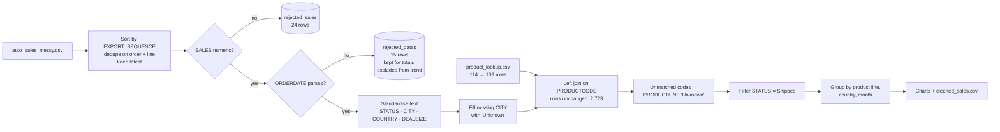
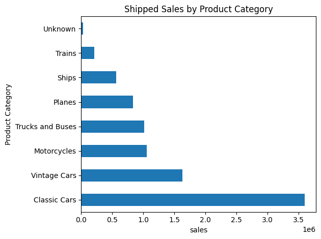
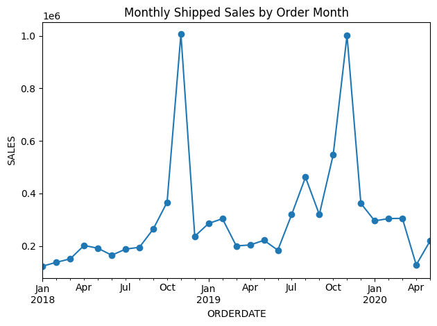

<div align="center">

# 🧹 Auto Sales — Data Cleaning & Validation Pipeline

**Mini Project 01 · Build Log**
*From a deliberately messy sales export to totals a manager can trust.*


[⬅ Back to the journey](../README.md) · [Portfolio](https://ahmed-al-rafsan.github.io/) · [LinkedIn](https://www.linkedin.com/in/ahmed-al-rafsan-/) · [YouTube](https://www.youtube.com/@AhmedAlRafsan)

</div>

---

## 📌 At a glance

| | |
|---|---|
| **Question** | Which product lines, countries and months drive *shipped* revenue — once the data can actually be trusted? |
| **Data** | Messy order-line export (scale-model vehicle orders, Jan 2018 – May 2020) + a product lookup table |
| **Approach** | Deduplicate → validate types → quarantine bad rows → standardise text → enrich with a lookup → aggregate |
| **Result** | 2,723 clean order lines, every rejected row kept for audit, and three answered business questions |
| **Tools** | Python · pandas · Matplotlib · Jupyter |

> **Why this project exists.** It is small on purpose. Most analysis mistakes are not modelling mistakes — they are a duplicated row, a sales value stored as `"3,871.00 "`, or a date read the American way. This build practises the unglamorous step every later stage depends on.

---

## 🧭 Table of contents

1. [Where this fits in my journey](#-where-this-fits-in-my-journey)
2. [Key findings](#-key-findings)
3. [The pipeline](#-the-pipeline)
4. [Data audit trail](#-data-audit-trail)
5. [Cleaning decisions, step by step](#-cleaning-decisions-step-by-step)
6. [Charts](#-charts)
7. [Repository structure](#-repository-structure)
8. [How to run](#-how-to-run)
9. [What I would do next](#-what-i-would-do-next)
10. [Skills demonstrated](#-skills-demonstrated)

---

## ✈️ Where this fits in my journey

I'm building toward this path, one deliberate project at a time:

```
Data Analyst  ──►  Analytics Engineer  ──►  Data Engineer  ──►  AI Engineer
   ▲ you are here
```

| Stage | What this project practises for it |
|---|---|
| **Data Analyst** | Turning a business question into grouped, sorted, charted answers |
| **Analytics Engineer** | Explicit cleaning rules, quarantine tables, row-count reconciliation — the habits that later become dbt tests |
| **Data Engineer** | Idempotent steps (sort → dedupe "keep latest"), lookup joins that must not inflate rows |
| **AI Engineer** | Clean, documented inputs — every model is only as honest as the table it learns from |

---

## 📊 Key findings

*Shipped orders only. Shipped orders make up **92.3%** of all clean sales value ($8.93M of $9.67M).*

| Question | Answer |
|---|---|
| 🏆 **Top product line** | **Classic Cars — $3,597,381.79** (40.3% of shipped sales) |
| 🌍 **Top country** | **USA — $3,073,693.88** (34.4% of shipped sales) |
| 📅 **Peak month** | **November 2018 — $1,006,660.70**, with **November 2019** close behind at $1,001,705.07 |

**Shipped sales by product line**

| Product line | Shipped sales | Share |
|---|---:|---:|
| Classic Cars | $3,597,381.79 | 40.3% |
| Vintage Cars | $1,626,010.11 | 18.2% |
| Motorcycles | $1,054,537.20 | 11.8% |
| Trucks and Buses | $1,010,715.42 | 11.3% |
| Planes | $836,824.98 | 9.4% |
| Ships | $561,290.41 | 6.3% |
| Trains | $211,787.82 | 2.4% |
| Unknown *(unmatched product codes)* | $33,132.05 | 0.4% |
| **Total** | **$8,931,679.78** | **100%** |

**Top five countries:** USA $3.07M · France $1.06M · Spain $1.03M · Australia $0.56M · UK $0.42M

**What it means**
- Revenue is concentrated: two product lines (Classic and Vintage Cars) account for **58.5%** of shipped sales.
- The business is strongly **seasonal** — sales build through October and peak in November in both full years, which matters for stock and staffing plans.
- Data-quality impact is small but *visible*: only 0.4% of shipped revenue sits in "Unknown", and it is reported rather than silently dropped.

---

## 🔁 The pipeline



---

## 🧾 Data audit trail

Every row that fails a check is accounted for — invalid rows are quarantined, not silently deleted.

| Step | Rows | Change | Where the removed rows went |
|---|---:|---|---|
| After deduplication (order + line, keep latest export) | 2,747 | — | — |
| Invalid `SALES` coerced to missing | **2,723** | −24 | `rejected_sales` |
| Invalid / missing `ORDERDATE` | 2,723 | 15 flagged | `rejected_dates` — still counted in product & country totals, excluded only from the monthly trend |
| Missing `CITY` | 2,723 | 10 filled → `Unknown` | kept — their sales are still valid |
| Product lookup | 114 → 109 | 5 duplicate codes removed | duplicates were checked first: identical line and MSRP |
| Left join with lookup | **2,723** | 0 | join verified not to inflate rows |
| Unmatched product codes | 2,723 | 10 → `Unknown` | codes `UNLISTED_001`–`UNLISTED_010` |

**Reconciliation check.** Shipped sales across product lines = **$8,931,679.78**. The monthly trend sums to **$8,881,966.14**. The $49,713.64 gap is exactly the shipped rows with an unreadable date — so the numbers tie out rather than drift.

---

## 🛠 Cleaning decisions, step by step

Organised by the checklist I use on every dataset — **PCUVCOD**: Profile, Completeness, Uniqueness, Validity, Consistency, Outliers, Document.

| Check | What I did | Why |
|---|---|---|
| **P**rofile | Inspected head, shape, dtypes and null counts | Know the data before changing it |
| **U**niqueness | Sorted by `EXPORT_SEQUENCE`, dropped duplicates on `ORDERNUMBER` + `ORDERLINENUMBER`, `keep="last"` | A re-exported line should keep its *latest* version, not a random one |
| **V**alidity | Stripped spaces and thousands separators from `SALES`, `pd.to_numeric(errors="coerce")` | Text that looks like a number isn't one until it's converted |
| **V**alidity | `pd.to_datetime(format="mixed", dayfirst=True, errors="coerce")`, original kept in `ORDERDATE_raw` | Australian-style `07/05/2018` is 7 May, not July 5 — and the raw value stays for audit |
| **C**ompleteness | Missing `CITY` → `Unknown`; unmatched `PRODUCTLINE` → `Unknown` | Keep the revenue, label the gap honestly |
| **C**onsistency | `.str.strip().str.title()` on status, city, country, deal size | `"shipped "` and `"Shipped"` must group together |
| **C**onsistency | Checked duplicate product codes agreed before dropping them | Never deduplicate a lookup blindly |
| **O**utliers | *Not yet done* — see [next steps](#-what-i-would-do-next) | Being honest about scope |
| **D**ocument | Quarantine tables, row counts, this README | Future-me is the first stakeholder |

---

## 📈 Charts

<p align="center">
  
  
</p>

*Left: shipped sales by product line. Right: monthly shipped sales — note the twin November peaks. May 2020 is the last month in the data and may be incomplete.*

---

## 🗂 Repository structure

```
Data-to-AI/
└── 01-auto-sales-data-cleaning/
    ├── data/
    │   ├── auto_sales_messy.csv       # raw order lines (input)
    │   └── product_lookup.csv         # product code → line, MSRP
    ├── images/
    │   ├── shipped_sales_by_product_line.png
    │   └── monthly_shipped_sales.png
    ├── output/
    │   └── cleaned_sales.csv          # enriched, cleaned order lines
    ├── Mini_Project_1.ipynb           # the full pipeline, top to bottom
    ├── requirements.txt
    └── README.md
```

---

## ▶️ How to run

```bash
git clone https://github.com/Ahmed-Al-Rafsan/Data-to-AI.git
cd Data-to-AI/01-auto-sales-data-cleaning
pip install -r requirements.txt
jupyter notebook Mini_Project_1.ipynb
```

Then choose **Kernel → Restart & Run All**. The notebook reads from `data/` and writes `output/cleaned_sales.csv`.

`requirements.txt`
```
pandas>=2.3
matplotlib>=3.8
jupyter
```

---

## 🔭 What I would do next

Each next step is also a step along the career path above.

- [ ] **Outlier review** — IQR check on `SALES`, `QUANTITYORDERED` and `PRICEEACH` to complete the PCUVCOD checklist.
- [ ] **Keep acronyms intact** — `.str.title()` turns `USA` into `Usa`; map country names to a reference list instead.
- [ ] **Validate `SALES = QUANTITYORDERED × PRICEEACH`** — a cross-column rule that catches silent errors.
- [ ] **Rebuild the same pipeline in SQL**, then as **dbt models with tests** (`unique`, `not_null`, `relationships`) — the analytics-engineering version of this project.
- [ ] **Move the steps into functions with `pytest` checks**, so the pipeline can run on a schedule — the data-engineering version.

---

## 🧠 Skills demonstrated

`pandas` data cleaning · type coercion with quarantine · day-first date parsing · composite-key deduplication · lookup joins with row-count checks · `groupby` aggregation · time-period analysis · Matplotlib charting · data-quality documentation

---

<div align="center">

**Ahmed Al Rafsan** · Data Analyst · Melbourne, Australia
*Engineering roots. People experience. A passion for finding the story in data.*

⭐ If this was useful, a star helps me know the build log is worth continuing.

</div>
