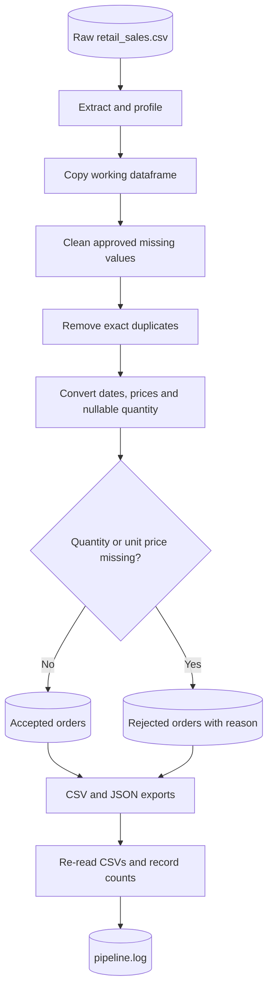

# Retail Sales ETL & Data Quality Pipeline

**A beginner-built, end-to-end local ETL project with traceable data-quality decisions.**

   

> **Project context:** A small, **synthetic** retail dataset used to practise data-engineering fundamentals. This is a local Jupyter implementation—not a scheduled cloud pipeline, production deployment, or real customer dataset. The notebook retains the learning-first style of the original author, with small adjustments for repository portability and reliable input handling. AI assisted with explanations, review and publishing documentation.

## Business problem

An incoming retail CSV contains exact duplicate rows, missing quantities, an invalid unit price and incomplete optional attributes. If those values go straight into revenue reporting, totals can be misleading. The goal is to produce a **calculation-ready** subset, quarantine incomplete orders for review and record processing outcomes without inventing numeric values.

## Architecture



[Mermaid source](docs/architecture.mmd) · [Project plan](docs/PROJECT_PLAN.md) · [Data dictionary](docs/DATA_DICTIONARY.md)

## Measured results

| Metric | Result |
|---|---:|
| Raw source | 58 rows × 12 columns |
| Exact duplicate rows removed | 2 |
| Unique rows after deduplication | 56 |
| Rejected for missing quantity | 2 |
| Rejected for invalid unit price | 1 |
| Accepted under current mandatory-price/quantity rules | **53** |
| Total rejected | **3** |

**Reconciliation:** 53 accepted + 3 rejected = 56 non-duplicate source rows. Counts were reproduced using the source CSV included in the repository.

## Data-quality rules and trade-offs

| Finding | Rule used | Why |
|---|---|---|
| Missing `ShippingState` | Set `Unknown` | Preserve the record without inventing a state |
| Exact duplicate across all columns | Retain first row | Prevent double-counting identical records |
| Missing `Quantity` | Quarantine | Do not replace unknown sales quantities with zero |
| `UnitPrice` = `not available` | Coerce to missing, quarantine | Avoid inventing a selling price |
| Missing `DiscountPct` | Retain missing | Zero discount is a distinct business claim |
| Order date stored as text | Parse to datetime | Enable time-aware analysis |

**Current scope:** Accepted means `Quantity` and `UnitPrice` passed the defined gate; it does **not** assert that all other attributes are complete. The source has no invalid date in this run, but an explicit required-date rejection rule is a future improvement. The first matching rejection reason is recorded if multiple issues occur in the same row. These limits are deliberate and documented.

## Run locally

1. Install Python 3.12 and Jupyter/VS Code.
2. Open this project folder (the folder containing `retail_sales.csv`) in VS Code.
3. Install dependencies: `python -m pip install -r requirements.txt`.
4. Open `retail_sales_ETL_pipeline.ipynb` and select your Python kernel.
5. Choose **Restart → Run All**. Run with the notebook's working directory set to this project folder.
6. Check `retail_accepted_file.csv`, `retail_rejected_file.csv`, corresponding JSON outputs, and `pipeline.log`.

The main notebook uses `Path.cwd() / 'retail_sales.csv'` so it does not contain a personal drive path. If Jupyter starts elsewhere, open the project folder as your workspace and run from there.

## Repository contents

```text
02-retail-sales-etl-data-quality/
├── README.md
├── retail_sales_ETL_pipeline.ipynb   # one main notebook
├── retail_sales.csv                 # synthetic input
├── retail_accepted_file.csv         # 53 accepted rows
├── retail_accepted_file.json        # 53 records
├── retail_rejected_file.csv         # 3 rejected rows, reason column
├── retail_rejected_file.json        # 3 rejected records
├── requirements.txt
├── .gitignore
└── docs/
    ├── PROJECT_PLAN.md
    ├── DATA_DICTIONARY.md
    ├── DECISIONS.md
    ├── VALIDATION_REPORT.md
    ├── AI_ASSISTANCE.md
    ├── architecture.mmd
    └── example_pipeline.log
```

The source notebook is a **portable reconstruction from the original author-shared code**, not a byte-for-byte upload of the local `.ipynb` file. See [AI assistance and provenance](docs/AI_ASSISTANCE.md). Replace this notebook with the author's exact VS Code file if preserving full local edit history and cell layout is preferred.

## Limitations and next steps

This is a single-file, manually run learning pipeline. It does not implement orchestration, incremental loads, cloud storage, automated business-rule configuration or production monitoring. Possible next upgrades: explicit date/discount policies, multi-reason rejection reporting, automated tests and cloud deployment. None is claimed as already implemented.

**Author:** [Ahmed Al Rafsan](https://github.com/Ahmed-Al-Rafsan) · [Portfolio](https://ahmed-al-rafsan.github.io/) · [LinkedIn](https://www.linkedin.com/in/ahmed-al-rafsan-/)